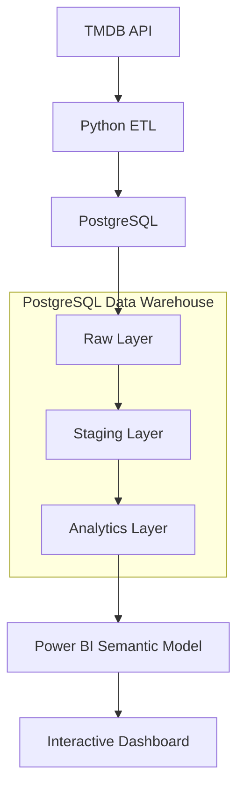

# TMDB Movie Trending Data Pipeline

## Overview

This project is an end-to-end Data Engineering and Business Intelligence solution that ingests daily trending movie data from the TMDB API, stores raw JSON payloads in PostgreSQL, transforms them into an analytics-ready star schema, and delivers an interactive Power BI dashboard.

The pipeline follows a layered architecture, separating raw ingestion, SQL transformations, and analytical reporting.

---

## Architecture

---

## Tech Stack

| Component | Technology |
|-----------|------------|
| Programming | Python |
| Database | PostgreSQL |
| Transformations | SQL |
| API | TMDB API |
| Visualization | Power BI |
| Version Control | Git & GitHub |

---

## Database Structure

### Raw Layer

| Table | Description |
|--------|-------------|
| `raw.tmdb_api_responses` | Raw JSON payloads retrieved from the TMDB API (one row per page, per snapshot). |

### Staging Layer

| Table | Description |
|--------|-------------|
| `staging.tmdb_movie_entries` | Flattened movie records with the original JSON payload. |
| `staging.tmdb_daily_metrics` | Cleaned daily rankings and extracted numeric metrics. |

### Analytics Layer

| Table | Description |
|--------|-------------|
| `analytics.fact_daily_movie` | Daily fact table containing rankings, popularity, vote metrics, and rank movement. |
| `analytics.dim_movie` | Movie metadata (title, overview, release date, language, etc.). |
| `analytics.dim_genre` | Genre reference dimension. |
| `analytics.bridge_movie_genre` | Bridge table supporting the many-to-many relationship between movies and genres. |
| `analytics.dim_calendar` | Calendar dimension used for reporting and time intelligence. |
| `analytics.dim_snapshot` | Snapshot dimension used to select the reporting date in Power BI while remaining disconnected from the fact table. |

---

## ETL Pipeline

The warehouse is populated through a sequential SQL pipeline:

| Order | Script |
|------:|--------|
| 20 | `20_load_raw_tables.sql` |
| 21 | `21_load_dim_calendar.sql` |
| 22 | `22_load_dim_movie.sql` |
| 23 | `23_load_bridge_movie_genre.sql` |
| 24 | `24_load_fact_table.sql` |
| 25 | `25_load_dim_snapshot.sql` |

---

## Pipeline Features

- Daily ingestion of TMDB trending movies
- Raw JSON storage for full traceability
- Layered warehouse architecture (Raw → Staging → Analytics)
- Idempotent loading using `ON CONFLICT`
- Rank change tracking (previous rank, rank delta, new entry detection)
- Analytics-ready star schema
- Snapshot-based reporting for historical analysis

---

## Power BI Dashboard

The dashboard is built using **Import Mode** and includes:

### Overview

- Daily KPIs
- Top Trending Movies
- Popularity analysis
- Rank movement insights
- Snapshot selector (defaults to the latest available snapshot)

### Movie Deep Dive

- Drillthrough page
- Historical ranking evolution
- Popularity trends over time
- Movie-level performance analysis

---

## Future Improvements

- **Schedule the pipeline using Apache Airflow or Prefect**  
  Automate daily ETL execution and monitoring.

- **Dockerize the application**  
  Package the ETL pipeline and PostgreSQL into reproducible containers.

- **CI using GitHub Actions**  
  Automatically validate the project whenever new code is pushed.

- **Automated data quality checks**  
  Validate the loaded data to detect missing, duplicate, or inconsistent records.

- **Expand the warehouse**  
  Add additional TMDB entities such as cast, crew, and production companies.